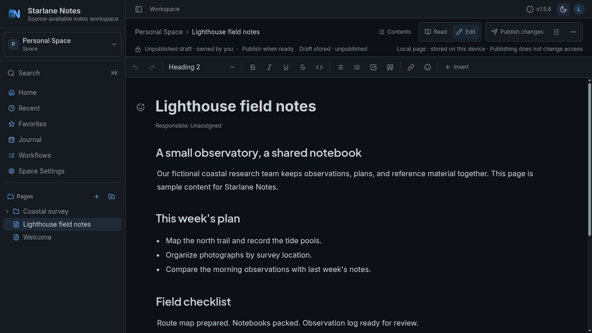
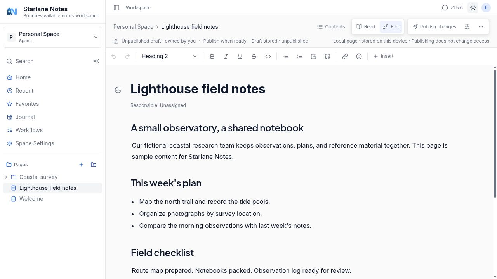
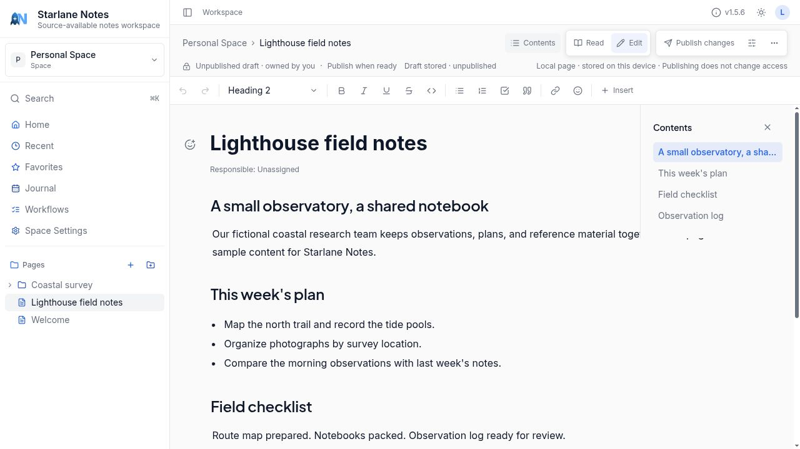
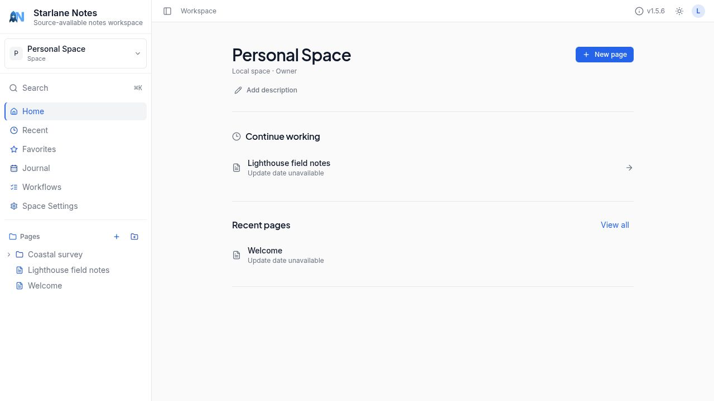

# Starlane Notes gallery

A short tour of writing and finding your way around Starlane Notes. These screenshots were
captured from the current v1.5.6 interface on October 26, 2026, using fictional Lighthouse field
notes in local browser mode. Select an image to open it at full size.

[Write in dark mode](#write-in-dark-mode) · [Switch to light mode](#switch-to-light-mode) ·
[Navigate a document](#navigate-a-document) · [Return to your workspace](#return-to-your-workspace)

## Write in dark mode

Keep the page tree beside your writing. The editor provides headings, lists and formatting controls;
the status strip distinguishes a stored draft from published content. This example remains an
unpublished local draft.

## Switch to light mode

The same document and controls in light appearance. Changing the theme keeps your writing and
workspace navigation in place.

## Navigate a document

Open **Contents** to see the document's headings alongside the editor. Select a heading to jump to
that section without leaving the page.

## Return to your workspace

**Home** brings you back to the space overview. Continue a recent draft or use the sidebar to open
pages and folders. The fictional Coastal survey folder and Lighthouse field notes appear here.

## Capture scope

These views demonstrate the local browser interface. They do not demonstrate connected sharing,
server administration, AI-provider operation, synchronization or physical-device support. Local
home cards currently display “Update date unavailable”; that limitation is visible in the capture.

[Back to the README](README.md) · [User guide](https://docs.starlanenotes.com/user-guide/workspace/)
