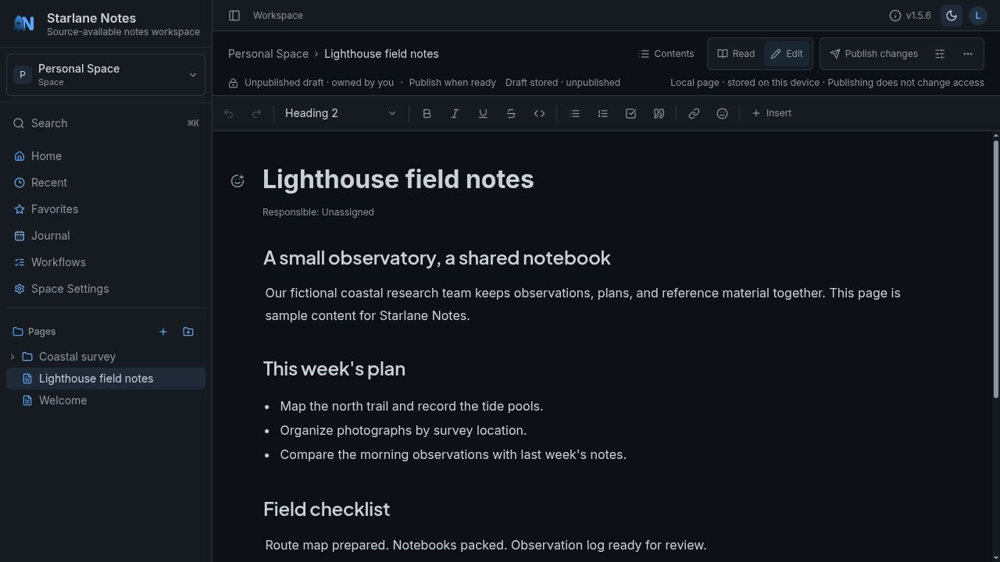
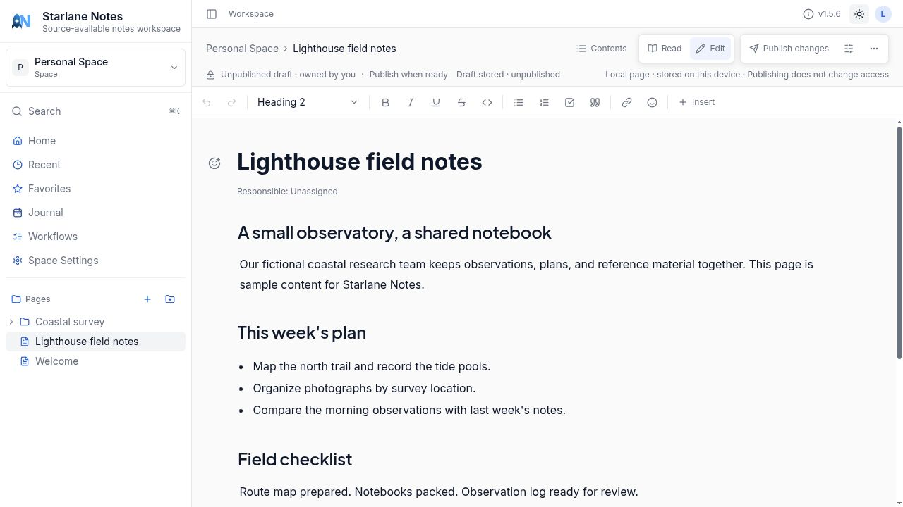
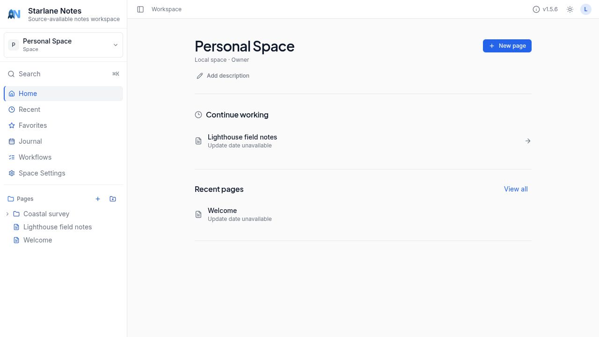

<p align="center">
  
</p>

# Starlane Notes

**A source-available, self-hosted, offline-first workspace for writing and organizing your documents.**

[](LICENSE) [](#quick-start) [](https://docs.starlanenotes.com)

[Quick start](#quick-start) · [Gallery](#gallery) · [Documentation](#documentation) · [Contributing](#contributing) · [License](#license)



## Why Starlane Notes?

- **Write with structure.** Edit documents with headings, lists, links, code and attachments.
- **Keep work organized.** Group pages into spaces and folders, with favorites and recent pages close at hand.
- **Find your notes.** Search documents without moving your knowledge into another service.
- **Choose where work lives.** Use local notes on your device or connect to your own server for shared workspaces.
- **Make AI optional.** Connect a supported provider when you want writing assistance; ordinary notes do not require one.

Local storage and connected workspaces have different access and synchronization behavior.
Collaboration foundations do not imply identical offline behavior on every platform. Desktop and
mobile shells require platform-specific builds; this README does not claim physical-device coverage.
PostgreSQL fresh installs, upgrades and core workflows have isolated Linux validation; see the
[validated scope and recovery limits](https://docs.starlanenotes.com/self-hosting/docker/#postgresql-configuration-and-validation-scope).

## Quick start

Use Docker Compose with a named volume. This avoids host-directory ownership setup.
You need Docker with Compose, `curl` and `openssl`.

The public snapshot uses GHCR. If the package requires authentication, run `docker login ghcr.io` first.

```bash
mkdir starlane-notes && cd starlane-notes
curl -fsSLo docker-compose.yml https://raw.githubusercontent.com/thetxeagle/starlanenotes/main/docker/docker-compose.volume.yml
curl -fsSLo .env https://raw.githubusercontent.com/thetxeagle/starlanenotes/main/docker/.env.example

JWT_SECRET="$(openssl rand -hex 32)"
sed -i.bak "s/^JWT_SECRET=.*/JWT_SECRET=${JWT_SECRET}/" .env
rm -f .env.bak

# Before public access: set BASE_URL in .env to your HTTPS URL.
docker compose pull
docker compose up -d
curl --retry 12 --retry-delay 5 --retry-connrefused -fsS http://localhost:9320/api/v1/health
```

Open [localhost:9320](http://localhost:9320) and complete setup. The first registered user becomes
administrator; finish setup before making the instance publicly reachable.

Back up the Compose-managed `starlane-notes-data` volume: it contains SQLite data, document files,
attachments and the search index. For reproducible upgrades, use a verified image digest;
version and commit-shaped tags can move.

For a new PostgreSQL deployment, use `docker/docker-compose.postgres.yml` and
`docker/.env.postgres.example`. Generate both required secrets. Switching Compose files does **not**
migrate an existing SQLite database. See the [Docker guide](https://docs.starlanenotes.com/self-hosting/docker/).

## Gallery

Real captures from v1.5.6 in local browser mode, using fictional content. They demonstrate the
interface, not server, collaboration or device acceptance.

[Open the full-size gallery and workflow tour](GALLERY.md).

| Light editor | Local workspace |
| --- | --- |
|  |  |

## Documentation

Read the [documentation](https://docs.starlanenotes.com), including
[environment variables](https://docs.starlanenotes.com/self-hosting/environment-variables/),
[upgrades](https://docs.starlanenotes.com/self-hosting/upgrading/),
[development setup](https://docs.starlanenotes.com/development/setup/) and
[troubleshooting](https://docs.starlanenotes.com/self-hosting/troubleshooting/).

For frontend development, run `npm ci` then `npm run dev`. Run `cargo run --package
starlane-notes-server` in another terminal for the backend. Native builds need their platform toolchains.

Gitea is canonical. This repository is a curated product snapshot with independent public history.
Documentation source and operator tooling stay private. See [public release notes](CHANGELOG.md).
Automatic desktop updates are disabled in this snapshot until a public signed update feed is configured.

## Contributing

Read the [contribution guide](CONTRIBUTING.md) before opening an issue
or pull request. Include your version, deployment method, reproduction steps and redacted logs.
Use [GitHub](https://github.com/thetxeagle/starlanenotes) for public reports and contributions.

## License

Starlane Notes is **source-available**, not OSI open source. Noncommercial use is covered by the
[PolyForm Noncommercial License 1.0.0](LICENSE). Names and logos are governed by
[TRADEMARKS.md](TRADEMARKS.md); modified distributions must use distinct branding.
