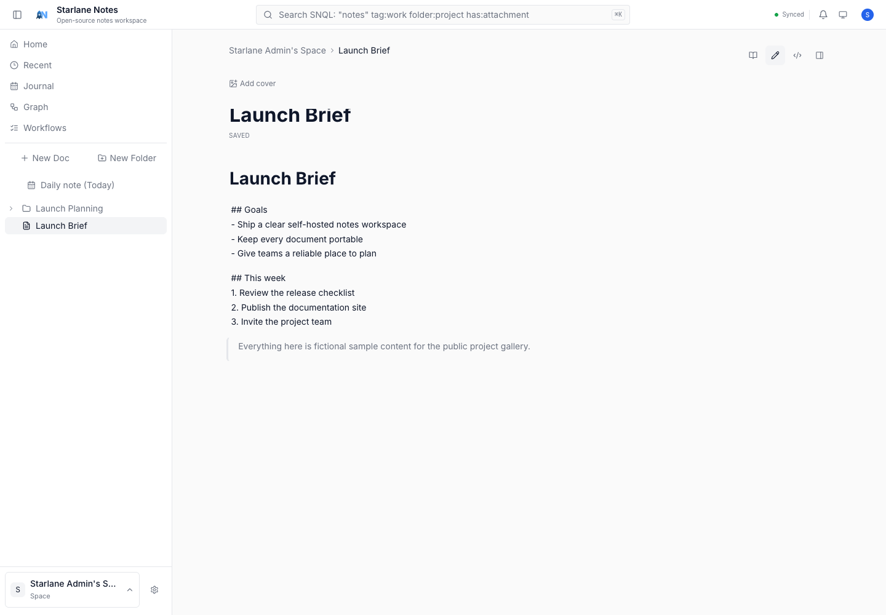
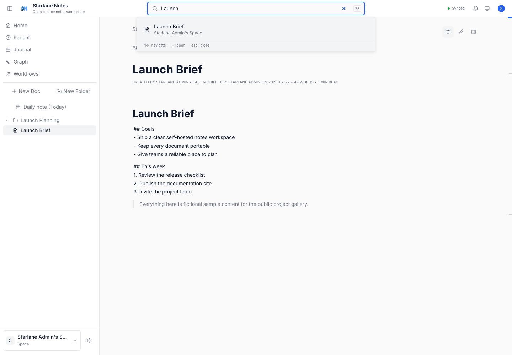
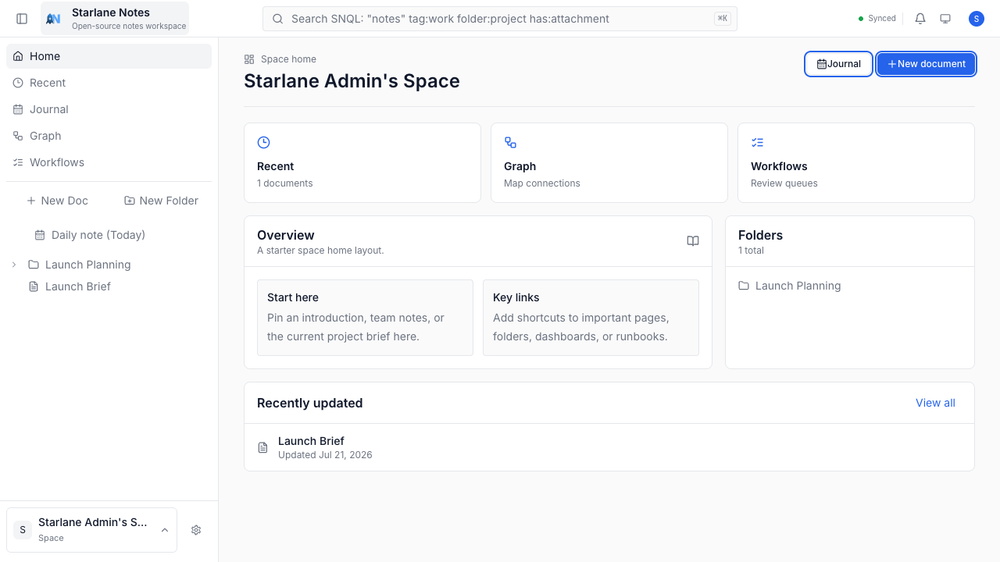
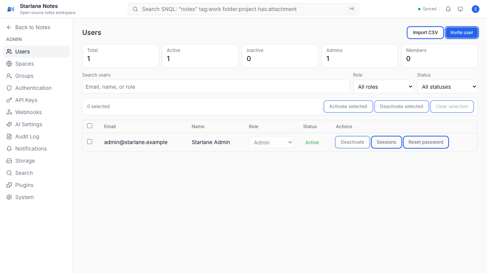

# Starlane Notes

<p align="center">
  
</p>

<p align="center">
  
</p>

<p align="center">
  <a href="https://github.com/hbftechnologies/starlanenotes/actions/workflows/docker-publish.yml"></a>
  <a href="LICENSE"></a>
  
  
</p>

<p align="center">
  <a href="#quick-start">Quick start</a> ·
  <a href="#screenshots">Screenshots</a> ·
  <a href="#documentation">Documentation</a> ·
  <a href="#development">Development</a> ·
  <a href="#contributing">Contributing</a>
</p>

**Starlane Notes is a fully open-source, self-hosted, offline-first document management platform.** It brings Markdown editing, spaces and folders, full-text search, collaboration foundations, optional AI workflows, and desktop/mobile shells into one deployable app.

Free forever. No paywalls. No vendor lock-in.

## Screenshots

| Writing | Search |
| --- | --- |
|  |  |

| Spaces | Site Administration |
| --- | --- |
|  |  |

## Features

- **Markdown-first writing** — Rich editing, live preview, and portable documents.
- **Organized workspaces** — Spaces, folders, users, groups, permissions, and public pages.
- **Search and retrieval** — Full-text search with structured SNQL filtering.
- **Local-first foundation** — Local vaults, queued recovery, and offline-friendly native shells.
- **Self-hosted deployment** — SQLite by default, PostgreSQL for larger deployments, and Docker images for amd64 and arm64.

## Quick start

Create a new directory and download the Compose files:

```bash
mkdir starlane-notes && cd starlane-notes
curl -fsSLO https://raw.githubusercontent.com/hbftechnologies/starlanenotes/main/docker/docker-compose.yml
curl -fsSLo .env https://raw.githubusercontent.com/hbftechnologies/starlanenotes/main/docker/.env.example

JWT_SECRET="$(openssl rand -hex 32)"
sed -i.bak "s/^JWT_SECRET=.*/JWT_SECRET=${JWT_SECRET}/" .env
rm -f .env.bak

mkdir -p storage
sudo chown -R 1000:1000 storage
docker compose up -d
curl -fsS http://localhost:9320/api/v1/health
```

Open [http://localhost:9320](http://localhost:9320) and complete setup. The first registered user is the administrator. Before publishing the instance, set `BASE_URL` in `.env` to its public HTTPS URL.

> [!WARNING]
> Back up `storage/` (or the named Docker volume). It holds the database, document files, attachments, and search index.

### Container images

GitHub Actions publishes both application and documentation images to GHCR:

```text
ghcr.io/hbftechnologies/starlanenotes:latest
ghcr.io/hbftechnologies/starlanenotes-docs:latest
```

Images publish `latest` from `main`, a version tag from `vX.Y.Z`, and an immutable `sha-<commit>` tag. If package visibility is private, authenticate first with `docker login ghcr.io`.

## Documentation

Deployment, authentication, storage, API, privacy, and development guides live in [`docs/docs/`](docs/docs/). The documentation portal can be built locally:

```bash
npm install
npm run docs:build
```

## Development

```bash
npm install

# Frontend
npm run dev

# Backend, in another terminal
cd server && cargo run

# Run the complete local container stack
cp docker/.env.example docker/.env
docker compose -f docker/docker-compose.dev.yml up --build
```

## Contributing

Issues and pull requests are welcome on [GitHub](https://github.com/hbftechnologies/starlanenotes). Please include the deployment method, Starlane Notes version, and relevant redacted logs with bug reports.

## License

MIT — see [LICENSE](LICENSE).
